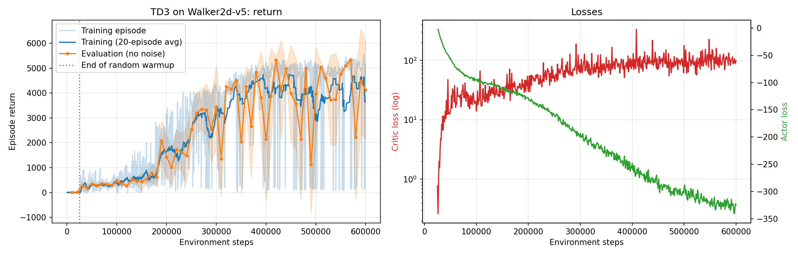
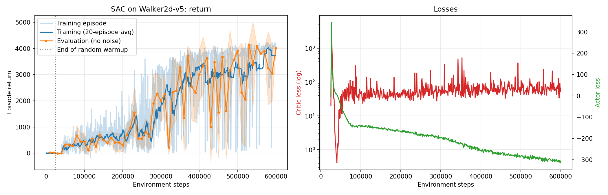
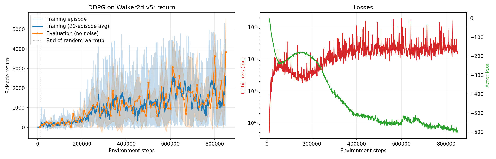

# Bipedal Payload Variation

**How well do deep reinforcement learning walking policies hold up when a bipedal robot carries extra weight?**

This project trains three continuous-control agents (DDPG, TD3 and SAC) on the MuJoCo **Walker2d-v5** biped, then tests how their learned gaits cope when the robot's torso gets heavier, as if it were wearing a heavy backpack. All code is written from scratch in PyTorch, with no RL libraries, so that every part of each algorithm is visible and easy to modify.

| Stage | Status |
|---|---|
| Environment and payload wrapper | Complete |
| Scripted (no-RL) baseline | Complete |
| DDPG agent | Trained, ~850k steps |
| TD3 agent | Trained, 600k steps |
| SAC agent | Trained, 600k steps |
| Payload evaluation of frozen policies | Complete |
| Payload-aware training | Not started |

---

## Table of Contents

- [Payload Results](#payload-results)
- [Training Results (normal mass)](#training-results-normal-mass)
- [Repository Structure](#repository-structure)
- [The Environment](#the-environment)
- [Simulating a Payload](#simulating-a-payload)
- [Algorithms](#algorithms)
- [Training and Evaluation Protocol](#training-and-evaluation-protocol)
- [Payload Evaluation Protocol](#payload-evaluation-protocol)
- [Getting Started](#getting-started)
- [Roadmap](#roadmap)
- [References](#references)

---

## Payload Results

The trained policies are **frozen** (no retraining) and run at torso masses from ×1.0 to ×2.0. All numbers come from `payload_eval.ipynb`.

### Reliability at normal mass

Before adding any weight, each policy ran once from each of 1,000 starting seeds (3000–3999) at ×1.0. "Survived" means it walked the full 1,000-step episode without falling.

| | DDPG | TD3 | SAC |
|---|---|---|---|
| Survival at ×1.0 (1,000 seeds) | 26.6% | 63.0% | **90.9%** |

SAC is by far the most reliable walker at the mass it was trained on, and DDPG is the least.

### Under payload (50 screened common seeds)

To separate "is the gait reliable?" from "does extra weight break it?", the payload sweep uses only the 50 seeds on which **all three** policies walk the full episode at ×1.0. Every curve therefore starts at 100%, so any drop is caused by the weight.

| Torso mass | DDPG survival | TD3 survival | SAC survival | DDPG distance | TD3 distance | SAC distance |
|---|---|---|---|---|---|---|
| ×1.0 | 100% | 100% | 100% | 28.5 m | 34.6 m | 25.0 m |
| ×1.25 | 28% | 72% | **86%** | 15.9 m | 30.3 m | 23.1 m |
| ×1.5 | 16% | 54% | **72%** | 11.3 m | 24.9 m | 23.3 m |
| ×1.75 | 8% | **60%** | 42% | 3.8 m | 24.5 m | 19.5 m |
| ×2.0 | 0% | **40%** | 20% | 0.5 m | 20.9 m | 16.9 m |

A second analysis uses up to 100 qualifying seeds per algorithm, chosen separately for each one. It gives the same overall picture: DDPG 0%, TD3 39% and SAC 24% survival at ×2.0. However, with this seed set SAC is ahead at ×1.75 (48% vs 38%).

**Findings**

- **DDPG is not robust to payload.** Survival drops from 100% to 28% with just 25% more torso mass, and by ×2.0 it barely moves forward.
- **SAC copes better with moderate loads (×1.25–×1.5); TD3 copes better with heavy loads (×2.0).** SAC's survival declines steadily and collapses past ×1.5. TD3 loses more seeds early on but then holds a plateau. Across all masses the two are roughly tied: per seed, TD3 survives on average 0.06 more masses than SAC. So neither is "more robust" overall; it depends on the size of the load.
- **TD3 walks furthest at every mass** because it is the fastest walker, although it slows from 4.3 m/s to 3.1 m/s as mass increases. SAC keeps almost exactly the same speed (about 3.1 m/s) whenever it stays upright.
- **All gaits sink and work harder under load.** Mean torso height falls and control effort rises with mass for every algorithm. SAC walks tallest (1.24 m at ×1.0) with the lowest effort; DDPG walks lowest with the highest effort.
- Falling is partly **chaotic** rather than a clean threshold. A policy can fall on a seed at one mass and finish the same seed at a heavier one, so single episodes (including the videos) should not be read as representative.

### Media

| File | Description |
|---|---|
| [`figures/robust_payload.png`](figures/robust_payload.png) | Distance, relative distance, survival, speed, torso height and control effort vs torso mass on the common seeds (mean ± 95% CI) |
| `videos/robust_walk_<algo>.mp4` | One grid video per algorithm showing the same starting seed (3092) at each torso mass |
| [`figures/payload_results.png`](figures/payload_results.png), `videos/payload_walk_<algo>.mp4` | Earlier unscreened 20-seed sweep (superseded by the screened test above) |

---

## Training Results (normal mass)

### TD3



- Learning starts quickly once the 25k-step random warmup ends. Evaluation return passes **~3,000 by roughly 300k steps** and settles around **4,000–5,000** from about 350k steps onward, peaking above 5,000.
- The critic loss stays bounded, and the actor loss (−Q) falls steadily, with no sign of the value estimates blowing up.
- Some individual evaluations still dip sharply (for example, around 500k steps), so the best checkpoint is kept rather than the final one.

### SAC



- Learning is slow for the first ~250k steps, with returns around 500. It then climbs steadily and reaches **~3,500–4,000** by 600k steps.
- Evaluation is noisy between 350k and 550k steps, with several dips to 1,000–2,000, but it trends upward to the end of training.
- The critic loss stays bounded, and the actor loss falls steadily throughout.

### DDPG



- Learning is slower and much noisier. After the first 600k steps, the best evaluation score was **2,295**, and the most recent one was **941 ± 743**.
- Training was then **resumed from the saved state** (same networks, optimizers and replay buffer) with a health-based stopping rule. It continued to **~850k total steps** and finished with an evaluation return of **~3,800**.
- The evaluation curve swings far more than TD3's, and the critic loss is roughly an order of magnitude more volatile. This is the overestimation instability that TD3 was designed to fix.

### Head-to-head (normal mass)

| | DDPG | TD3 | SAC |
|---|---|---|---|
| Steps to reach ~2,000 eval return | ~550k | ~200k | ~280k |
| Typical eval return at 600k steps | ~1,000–2,500 | ~4,000–5,000 | ~3,500–4,000 |
| Stability of evaluation curve | High variance, frequent collapses | Occasional dips, recovers quickly | Noisy mid-training, steady at the end |
| Survival at ×1.0 over 1,000 seeds (saved policy) | 26.6% | 63.0% | 90.9% |

> Training figures come from single-seed training curves, so treat them as indicative rather than statistically conclusive. Warmup length also differs (10k steps for DDPG, 25k for TD3 and SAC). Evaluation return measures reward over 5 episodes, while the survival row measures reliability across many starting conditions, which is why the rankings differ.

### Other media

| File | Description |
|---|---|
| [`videos/walker_no_rl_baseline.mp4`](videos/walker_no_rl_baseline.mp4) | Scripted PD stepping controller with no learning. It falls within ~1.2 s every episode, which confirms the task isn't trivially solvable. |
| [`videos/ddpg_walker.mp4`](videos/ddpg_walker.mp4), [`videos/sac_walker.mp4`](videos/sac_walker.mp4) | Policy rollouts at normal mass, with a camera that follows the walker |

---

## Repository Structure

```
.
├── bipedal_ddpg.ipynb      # Environment, scripted baseline, and DDPG agent
├── bipedal_td3.ipynb       # Same environment and building blocks, plus the TD3 agent
├── bipedal_sac.ipynb       # Same environment and building blocks, plus the SAC agent
├── payload_eval.ipynb      # Loads the saved policies and runs every payload test
├── models/                 # Saved actor weights (<algo>_actor.pt) and per-seed reference distances (<algo>_reference.json)
├── results/                # Payload test CSVs: robust_* (screened test) and payload_* (earlier 20-seed sweep)
├── figures/                # Learning curves (<algo>_convergence.png) and payload plots
├── videos/                 # Rollouts at normal mass, payload gait videos, and the scripted baseline
├── LICENSE
└── README.md
```

Each training notebook is self-contained and runs top to bottom. All three share identical code for the environment factory, `Critic` and `ReplayBuffer` (and DDPG and TD3 share the same `Actor`), so differences in results come from the algorithm itself. Each training notebook ends with a save cell that writes `<algo>_actor.pt` and `<algo>_reference.json`; move them into `models/`, where `payload_eval.ipynb` loads them from.

---

## The Environment

[**Walker2d-v5**](https://gymnasium.farama.org/environments/mujoco/walker2d/) (Gymnasium ≥ 1.2, MuJoCo ≥ 3.3) is a planar biped with a torso and two legs, each with a thigh, a shin and a foot.

| Property | Value |
|---|---|
| Observation | 17-D: torso height and angle, 6 joint angles, torso velocities, 6 joint velocities |
| Action | 6-D continuous joint torques in [−1, 1] |
| Control timestep | 0.008 s (125 Hz) |
| Episode length | Up to 1,000 steps (8 s) |
| Reward | Forward velocity + 1.0 per step for staying healthy − 0.001 × ‖action‖² |
| Termination ("unhealthy") | Torso height leaves [0.8, 2.0] m, or torso angle leaves [−1, 1] rad |
| Default masses | Torso 3.665 kg; whole robot 23.677 kg |

The reward and physics are **left at the Gymnasium defaults**, so results are comparable with published benchmarks.

---

## Simulating a Payload

Payload is modelled by the `FixedTorsoMass` wrapper, created through a single factory function:

```python
env = make_env()                        # normal torso
env = make_env(torso_mass_scale=1.5)    # torso 50% heavier
env = make_env(torso_mass_scale=2.0)    # torso mass doubled
```

The wrapper multiplies the torso's **mass and rotational inertia** by the same factor, then calls `mujoco.mj_setConst` so that MuJoCo recomputes the quantities that depend on mass and inertia. This represents a *denser torso of unchanged shape*:

- It does **not** shift the centre of mass or attach an offset backpack.
- Doubling the torso mass does **not** double the whole robot's mass (3.7 kg of 23.7 kg), so ×2.0 adds about 15% to the robot's total mass.

---

## Algorithms

All agents use the same critic architecture, and DDPG and TD3 share the same actor:

| Network | Architecture |
|---|---|
| Actor (DDPG, TD3) | 17 → 256 → 256 → 6, ReLU hidden layers, `tanh` output |
| Actor (SAC) | 17 → 256 → 256, then separate mean and log-std heads (6 each); log-std clamped to [−20, 2] |
| Critic | (17 + 6) → 256 → 256 → 1, ReLU hidden layers |

### DDPG: Deep Deterministic Policy Gradient

One actor and one critic, each with a slowly updated target copy. The critic learns from the Bellman target $r + \gamma(1-d)\,Q'(s', \mu'(s'))$, and the actor follows the critic's gradient. Because a single critic's errors are maximised by the actor, DDPG is prone to **Q-value overestimation**.

### TD3: Twin Delayed DDPG

TD3 adds three fixes to DDPG:

1. **Clipped double-Q learning.** Two independent critics; the target uses the *minimum* of their two estimates, which counteracts overestimation.
2. **Target policy smoothing.** Clipped Gaussian noise is added to the target action, so the critic can't exploit sharp, narrow peaks in its own value estimate.
3. **Delayed policy updates.** The actor and all target networks update once for every 2 critic updates, so the policy follows a steadier critic.

### SAC: Soft Actor-Critic

SAC learns a **stochastic** policy: a Gaussian whose sample is squashed through `tanh`, with a log-probability correction for the squashing. It keeps TD3's twin critics and minimum, but differs in three ways:

1. **Entropy bonus.** The target is $r + \gamma(1-d)\,[\min(Q'_1, Q'_2)(s', a') - \alpha \log \pi(a' \mid s')]$ with $a' \sim \pi(\cdot \mid s')$, so the policy is rewarded for staying random where it can.
2. **Automatic temperature.** $\alpha$ is learned so that the policy's entropy tracks a target of −6 (minus the action dimension).
3. **No target actor and no added noise.** Exploration comes from sampling the policy itself, and the actor updates every step. At evaluation time the policy acts deterministically with `tanh(mean)`.

### Hyperparameters

| Parameter | DDPG | TD3 | SAC |
|---|---|---|---|
| Discount γ | 0.99 | 0.99 | 0.99 |
| Target update rate τ | 0.005 | 0.005 | 0.005 |
| Optimizer / learning rate | Adam, 3e-4 | Adam, 3e-4 | AdamW, 3e-4 (actor, critics and α) |
| Batch size | 256 | 256 | 256 |
| Replay buffer | 1M transitions | 1M transitions | 1M transitions |
| Random warmup | 10k steps | 25k steps | 25k steps |
| Exploration | Gaussian noise, std 0.1 | Gaussian noise, std 0.1 | Sampled from the policy |
| Target policy noise / clip | — | 0.2 / 0.5 | — |
| Policy delay | 1 (every step) | 2 | 1 (every step) |
| Entropy target | — | — | −6, with learned α |
| Training steps | 600k, then continued to ~850k | 600k | 600k |

---

## Training and Evaluation Protocol

- **Off-policy loop:** one gradient update per environment step after warmup. Transitions store `terminated` (the robot fell), not `truncated` (the time limit was reached), so a time limit is never treated as a true ending when computing targets.
- **Periodic evaluation:** every 10k steps, the policy runs **without exploration noise** for 5 episodes on a separate environment. The mean ± standard deviation is plotted live.
- **Best-checkpoint selection:** the actor with the highest evaluation return is saved and restored at the end of training, because all three algorithms can dip after peaking.
- **Health-based continuation (DDPG):** a resumable training cell continues from the current state and stops once all 5 fixed evaluation seeds (100–104) survive the full 1,000-step episode.
- **Videos:** a side-view camera follows the torso's forward position each frame, so the walker stays centred for the whole episode.
- **Reproducibility:** fixed seeds for PyTorch, NumPy, Python's `random` module and the environment.

---

## Payload Evaluation Protocol

`payload_eval.ipynb` loads the saved actors and never trains them further.

1. **Sanity checks.** The torso mass is confirmed to change; the same seed and mass give an identical result when run twice; and each loaded policy reproduces the per-seed distances in its `<algo>_reference.json`.
2. **Unscreened sweep.** 20 seeds (2000–2019) at ×1.0, 1.5, 1.75 and 2.0, with summary tables, plots and gait videos. This version mixes "the gait was unreliable" with "the weight broke the gait", because many seeds already fall at ×1.0.
3. **Screening.** Each policy runs on 1,000 seeds (3000–3999) at ×1.0. The unscreened survival rate is reported, and the seeds on which a policy walks the full episode are kept as qualifying seeds.
4. **Screened sweep.** Each policy runs at every test mass on two seed sets: the first 50 seeds that qualify for all three policies (the **common** seeds, for a like-for-like comparison) and up to 100 qualifying seeds per policy. Rerunning at ×1.0 must give 100% survival; this doubles as a determinism check.
5. **Plots and videos.** Mean ± 95% CI vs torso mass on the common seeds, plus grid videos of one common seed at each mass.

Every episode is deterministic (the actor's mean action, with no noise), so the only randomness is the starting state chosen by the seed. The same seeds are used at every mass, so each comparison is paired.

Results are exactly reproducible only within the same software installation. Tiny floating-point differences between Python, PyTorch or BLAS builds grow over 1,000 chaotic simulation steps, so another machine can give different per-seed outcomes. The reference-distance sanity check detects this.

---

## Getting Started

### Requirements

- Python 3.10+ (developed on 3.11)
- No GPU required. Development used an Apple-silicon Mac; training runs at about 380–420 environment steps per second.

### Install

```bash
pip install "gymnasium[mujoco]>=1.2,<2" "mujoco>=3.3,<4" torch numpy pandas matplotlib imageio imageio-ffmpeg pillow
```

The first cell of each training notebook also installs these automatically.

### Rendering backend

The environment cell selects the renderer automatically:

| Platform | `MUJOCO_GL` | Notes |
|---|---|---|
| macOS | `glfw` | Works out of the box |
| Linux / Google Colab | `osmesa` | CPU software rendering; installs `libosmesa6` via `apt-get` if it's missing |

### Run

1. Open `bipedal_ddpg.ipynb`, `bipedal_td3.ipynb` or `bipedal_sac.ipynb` in Jupyter, VS Code or Cursor.
2. **Restart the kernel and run all cells.** The final cell saves the actor weights for the payload tests.
3. Move the saved `<algo>_actor.pt` and `<algo>_reference.json` files into `models/`, then open `payload_eval.ipynb` and run all cells. Outputs are written to `results/`, `figures/` and `videos/`. The screened test takes roughly 10 minutes on a laptop CPU.

> **Tip:** use `torch.set_num_threads(1)`. With networks this small, extra CPU threads add overhead and slowed training by about 25% in testing.

---

## Roadmap

- [x] **SAC:** add Soft Actor-Critic as a third algorithm.
- [x] Save trained weights (`.pt`) so policies can be evaluated without retraining.
- [x] **Payload sweep:** evaluate the frozen policies at a range of torso masses, measuring distance, survival, speed, torso height and control effort.
- [x] **Statistical rigour (evaluation):** many starting seeds per configuration, a paired design and 95% confidence intervals.
- [ ] **Statistical rigour (training):** train several seeds per algorithm, since each result above comes from a single training run.
- [ ] **Payload-aware training:** train with a randomised torso mass (domain randomisation) and compare robustness against agents trained only on the nominal mass.
- [ ] **Offset backpack:** add a payload that shifts the centre of mass backward, closer to a real backpack.
- [ ] **Matched comparison:** equalise warmup length (and other settings) across the three algorithms, so differences can be attributed to the algorithm alone.

---

## References

1. Lillicrap, T. P., et al. *Continuous control with deep reinforcement learning* (DDPG). ICLR 2016. [arXiv:1509.02971](https://arxiv.org/abs/1509.02971)
2. Fujimoto, S., van Hoof, H., & Meger, D. *Addressing Function Approximation Error in Actor-Critic Methods* (TD3). ICML 2018. [arXiv:1802.09477](https://arxiv.org/abs/1802.09477)
3. Haarnoja, T., et al. *Soft Actor-Critic Algorithms and Applications* (SAC). 2018. [arXiv:1812.05905](https://arxiv.org/abs/1812.05905)
4. Towers, M., et al. *Gymnasium: A Standard Interface for Reinforcement Learning Environments.* 2024. [arXiv:2407.17032](https://arxiv.org/abs/2407.17032)
5. Todorov, E., Erez, T., & Tassa, Y. *MuJoCo: A physics engine for model-based control.* IROS 2012.

---

## License

Released under the MIT License. See [LICENSE](LICENSE).
