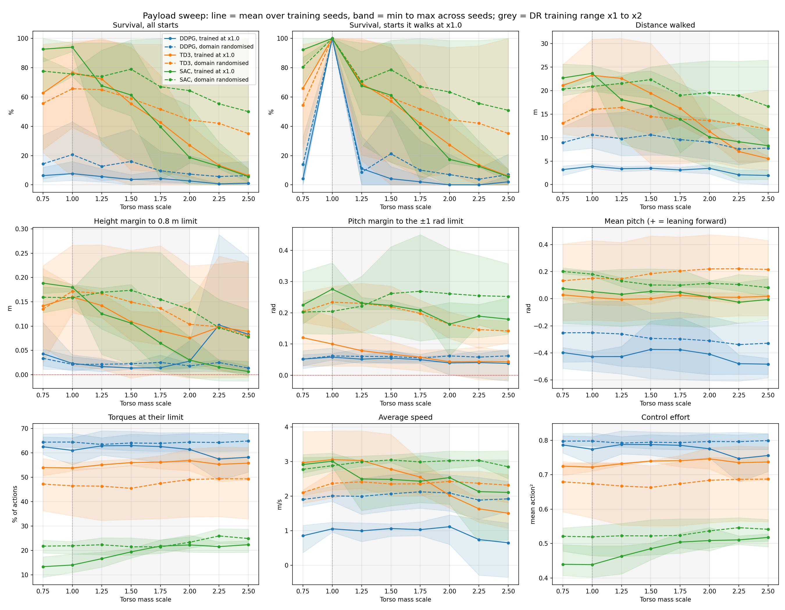
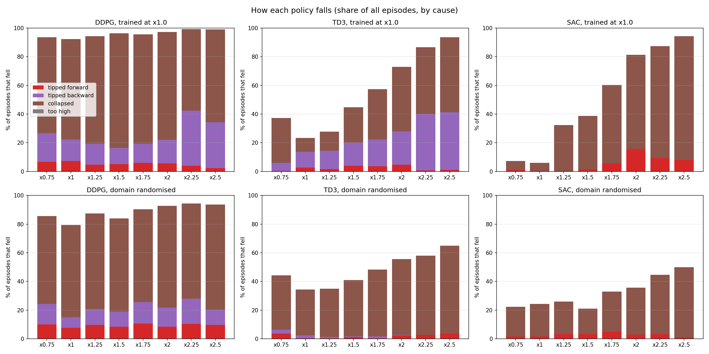
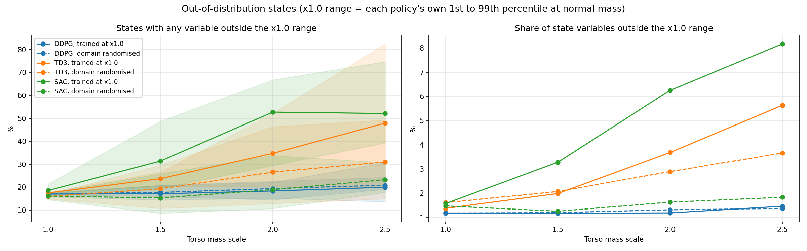
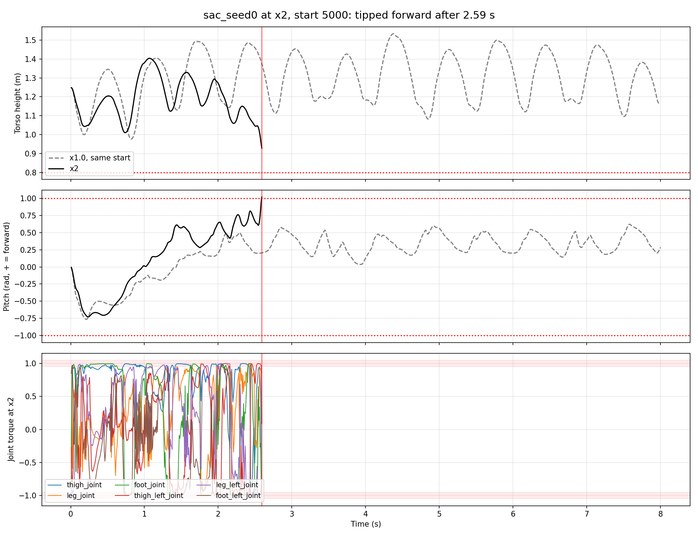

# Bipedal Payload Variation

**Do off-policy actor-critic walking policies keep working when a bipedal robot carries extra load, and does training on varied loads make them robust?**

This project trains three continuous-control agents (DDPG, TD3 and SAC) on the MuJoCo **Walker2d-v5** biped and measures how their gaits hold up as the robot's torso gets heavier. Each algorithm is trained two ways: only at the normal torso mass, and with **domain randomization** over torso mass. All algorithms are implemented from scratch in PyTorch with matched settings, so differences in results can be attributed to the algorithms themselves.

| Component | Status |
|---|---|
| Environment and payload wrappers (fixed and randomized mass) | Complete |
| DDPG, TD3 and SAC with matched settings (`train.py`) | Complete |
| 18 training runs: 3 algorithms × 2 training conditions × 3 seeds | Complete |
| Payload evaluation with failure diagnosis (`payload_eval.ipynb`) | Complete |
| Offset (backpack-style) payload | Not started |

---

## Table of Contents

- [Summary of Findings](#summary-of-findings)
- [Experimental Design](#experimental-design)
- [Results](#results)
- [Why Policies Fail Under Load](#why-policies-fail-under-load)
- [Limitations](#limitations)
- [The Environment](#the-environment)
- [Modelling the Payload](#modelling-the-payload)
- [Algorithms](#algorithms)
- [Reproducing the Results](#reproducing-the-results)
- [Repository Structure](#repository-structure)
- [Legacy Single-Seed Results](#legacy-single-seed-results)
- [References](#references)

---

## Summary of Findings

1. **Policies trained at a single mass are not robust to load.** Survival for SAC falls from 94% at normal mass to 19% at ×2.0 torso mass; TD3 falls from 77% to 27%.
2. **Domain randomization over mass restores most of that robustness**, at a modest cost at normal mass. At ×2.0, randomized SAC survives 64% and randomized TD3 44%.
3. **The benefit extends beyond the training range.** At ×2.5, a mass never seen in training, randomized SAC survives 50% against 6% for SAC trained at normal mass.
4. **SAC is the most robust algorithm at every load.** It is also the most consistent across training seeds and saturates its torques about a third as often as TD3 or DDPG.
5. **DDPG is the weakest at every load** and rarely completes an episode from a random start, even at normal mass.
6. **Randomization works by keeping the robot in familiar states.** At ×2.0, 53% of the states visited by normally trained SAC fall outside its normal-mass range, against 19% for randomized SAC.
7. **Results vary strongly between training seeds.** For example, randomized TD3 survives 94% at ×2.0 with one seed and 0% with another.

---

## Experimental Design

The experiment has two phases: **training** produces 18 policies, and **testing** evaluates every frozen policy under a range of loads.

### Phase 1: Training

| Factor | Levels |
|---|---|
| Algorithm | DDPG, TD3, SAC |
| Training condition | **Normal**: torso mass fixed at ×1.0. **Randomized**: torso mass drawn uniformly from ×1.0 to ×2.0 at the start of every episode. |
| Training seed | 0, 1, 2 |

- **Training conditions.** The normal condition is the standard setup. The randomized condition (domain randomization) exposes the policy to many loads during training, so it must learn a single gait that works across them. The question is whether this produces a policy that is robust at test time, including at loads outside the training range.
- **Training seeds.** A seed fixes all randomness in a training run: initial network weights, the random warm-up actions, exploration noise, replay sampling and the environment. Each configuration is trained with three seeds to measure how much the outcome depends on the individual run. Results are reported as the mean and standard deviation across seeds.
- **Checkpoints.** Every 10,000 steps, each run evaluates its current policy deterministically on 5 episodes (start states 10000–10004) and keeps the best-scoring version. Normal runs score at ×1.0; randomized runs score on the average return at ×1.0, ×1.5 and ×2.0. The best checkpoint from each run is the policy that is tested; there is one checkpoint per seed.
- **Matched settings.** All 18 runs use 600,000 environment steps, a 25,000-step random warm-up, Adam with learning rate 3 × 10⁻⁴, batch size 256, γ = 0.99, τ = 0.005 and a 1M-transition replay buffer (see [Hyperparameters](#hyperparameters)).

### Phase 2: Testing

Each of the 18 checkpoints is frozen and run deterministically (no exploration noise) under the following conditions:

| Setting | Value |
|---|---|
| Torso mass | ×0.75, 1.0, 1.25, 1.5, 1.75, 2.0, 2.25, 2.5 |
| Held-out masses | ×0.75, ×2.25 and ×2.5 lie outside the randomized training range |
| Start states | The same 100 start states (seeds 5000–5099) for every policy and mass |
| Total | 18 policies × 8 masses × 100 start states = 14,400 episodes |

Start states are independent of training seeds: they determine the robot's initial pose and velocity in each test episode. Because every policy is tested from the same start states at every mass, all comparisons are paired. Each episode uses a freshly constructed environment so that a mass setting cannot carry over between runs.

**Sanity checks** run before the sweep: the torso mass changes as intended, repeated runs are bit-for-bit identical, and every checkpoint reproduces the distances it recorded at the end of training (start states 100–104).

### What each analysis tests

| Analysis | Question |
|---|---|
| Payload sweep, normal training | How does each algorithm degrade as load increases? |
| Normal vs randomized training | Does training on varied mass produce robustness, including at held-out masses? |
| Algorithm comparison | Which algorithm is most robust, and how do their gaits differ? |
| Variation across seeds | How dependent is each result on the individual training run? |
| Failure diagnosis | How do policies fall, how close do they come to the termination limits, and how often are torques saturated? |
| Out-of-distribution state check | Does added load push the robot into states the policy did not visit at normal mass? |

### Metrics

| Metric | Definition |
|---|---|
| Survival | Share of episodes that reach the 1,000-step limit without falling |
| Survival given ×1.0 | Survival restricted to start states from which the same policy completes the episode at ×1.0, which isolates the effect of the load |
| Distance | Forward displacement of the torso over the episode (m) |
| Height margin | Lowest torso height minus the 0.8 m termination limit (m) |
| Pitch margin | 1 rad minus the largest absolute torso pitch (rad) |
| Saturation | Share of joint torque commands with magnitude above 0.95 |
| Failure type | Collapsed (height below 0.8 m), tipped forward or tipped backward (pitch beyond ±1 rad) |

---

## Results

All values are the mean ± standard deviation across the three training seeds, each evaluated on 100 start states. Bold marks the best condition at each mass.

### Survival (%)

| Torso mass | DDPG normal | DDPG randomized | TD3 normal | TD3 randomized | SAC normal | SAC randomized |
|---|---|---|---|---|---|---|
| ×0.75 (held out) | 6 ± 5 | 14 ± 17 | 63 ± 35 | 56 ± 37 | **93 ± 8** | 78 ± 13 |
| ×1.0 | 8 ± 7 | 21 ± 19 | 77 ± 33 | 66 ± 52 | **94 ± 3** | 76 ± 2 |
| ×1.25 | 6 ± 5 | 13 ± 17 | 72 ± 37 | 65 ± 51 | 68 ± 36 | **74 ± 19** |
| ×1.5 | 4 ± 4 | 16 ± 19 | 55 ± 42 | 59 ± 52 | 61 ± 41 | **79 ± 28** |
| ×1.75 | 4 ± 5 | 10 ± 12 | 43 ± 33 | 52 ± 48 | 40 ± 28 | **67 ± 55** |
| ×2.0 | 3 ± 3 | 7 ± 11 | 27 ± 19 | 44 ± 47 | 19 ± 31 | **64 ± 44** |
| ×2.25 (held out) | 1 ± 1 | 6 ± 8 | 13 ± 12 | 42 ± 48 | 13 ± 15 | **55 ± 44** |
| ×2.5 (held out) | 1 ± 1 | 6 ± 8 | 6 ± 5 | 35 ± 56 | 6 ± 6 | **50 ± 49** |

### Distance walked (m)

| Torso mass | DDPG normal | DDPG randomized | TD3 normal | TD3 randomized | SAC normal | SAC randomized |
|---|---|---|---|---|---|---|
| ×0.75 | 3.2 ± 1.1 | 8.9 ± 2.9 | 21.1 ± 7.7 | 13.1 ± 3.5 | **22.7 ± 2.8** | 20.3 ± 1.3 |
| ×1.0 | 3.9 ± 0.6 | 10.6 ± 3.9 | 23.3 ± 9.7 | 16.0 ± 5.5 | **23.7 ± 1.6** | 20.9 ± 1.6 |
| ×1.5 | 3.5 ± 0.5 | 10.6 ± 5.3 | 19.4 ± 9.8 | 14.5 ± 8.9 | 16.7 ± 8.8 | **22.4 ± 3.6** |
| ×2.0 | 3.5 ± 1.0 | 9.1 ± 4.5 | 11.3 ± 1.8 | 13.6 ± 7.5 | 10.1 ± 7.7 | **19.6 ± 7.4** |
| ×2.5 | 1.9 ± 1.7 | 7.8 ± 3.3 | 5.5 ± 0.6 | 11.8 ± 8.5 | 8.3 ± 6.2 | **16.7 ± 9.3** |

### Best condition at each load

| Load | Best condition | Survival | Runner-up |
|---|---|---|---|
| ×0.75 to ×1.0 | SAC, normal training | 93–94% | SAC randomized (76–78%) |
| ×1.25 to ×2.0 | SAC, randomized training | 64–79% | TD3 normal at ×1.25, TD3 randomized above |
| ×2.25 to ×2.5 (held out) | SAC, randomized training | 50–55% | TD3 randomized (35–42%) |

### Survival per training seed (%)

| Condition | Seeds 0 / 1 / 2 at ×1.0 | at ×2.0 | at ×2.5 |
|---|---|---|---|
| DDPG normal | 4 / 3 / 16 | 1 / 1 / 6 | 2 / 0 / 1 |
| DDPG randomized | 11 / 43 / 8 | 1 / 20 / 1 | 2 / 16 / 1 |
| TD3 normal | 95 / 39 / 96 | 35 / 5 / 41 | 11 / 1 / 7 |
| TD3 randomized | 98 / 6 / 93 | 94 / 0 / 39 | 100 / 0 / 5 |
| SAC normal | 97 / 94 / 91 | 0 / 54 / 2 | 6 / 11 / 0 |
| SAC randomized | 78 / 75 / 74 | 79 / 15 / 99 | 48 / 2 / 100 |

The single most robust policy is randomized TD3 with seed 0, but another randomized TD3 seed failed to learn a reliable gait. SAC ranks first on average because its seeds agree far more closely.

### Training performance

Best evaluation return reached during training (5 episodes, used for checkpoint selection):

| Condition | Seed 0 | Seed 1 | Seed 2 |
|---|---|---|---|
| DDPG normal | 1,213 | 1,455 | 1,277 |
| DDPG randomized | 1,953 | 2,951 | 1,613 |
| TD3 normal | 4,918 | 3,252 | 4,356 |
| TD3 randomized | 3,314 | 1,392 | 3,776 |
| SAC normal | 3,953 | 3,886 | 4,487 |
| SAC randomized | 3,808 | 3,436 | 4,088 |

Randomized returns are averaged over ×1.0, ×1.5 and ×2.0, so they are not directly comparable to normal returns. In SAC, the learned temperature α fell from 0.74 to 0.06–0.09 in all six runs, and policy entropy settled at its target of −6. Learning curves for each run are in `figures/training/`.

### Figures



Survival, conditional survival, distance, height and pitch margins, mean pitch, torque saturation, speed and control effort against torso mass. Solid lines are normal training, dashed lines are randomized training, bands span the minimum and maximum across seeds, and the grey region marks the randomized training range.

---

## Why Policies Fail Under Load

### Failure type



Most failures under load are **collapses**: the torso sinks below the 0.8 m limit. Backward tipping grows with mass for normally trained TD3, reaching about 40% of episodes at ×2.5, and normally trained SAC begins to tip forward at ×2.0.

### Gait diagnostics

Values at ×1.0 → ×2.0 → ×2.5, averaged over seeds:

| Condition | Torques saturated (%) | Pitch margin (rad) | Mean pitch (rad, positive = forward) |
|---|---|---|---|
| DDPG normal | 61 → 61 → 58 | 0.06 → 0.04 → 0.04 | −0.43 → −0.41 → −0.48 |
| DDPG randomized | 64 → 64 → 65 | 0.06 → 0.06 → 0.06 | −0.25 → −0.31 → −0.33 |
| TD3 normal | 54 → 57 → 56 | 0.10 → 0.04 → 0.04 | 0.01 → 0.01 → 0.02 |
| TD3 randomized | 46 → 49 → 49 | 0.23 → 0.16 → 0.14 | 0.15 → 0.22 → 0.22 |
| SAC normal | 14 → 22 → 22 | 0.28 → 0.16 → 0.18 | 0.05 → 0.01 → −0.01 |
| SAC randomized | 22 → 23 → 25 | 0.20 → 0.26 → 0.25 | 0.18 → 0.11 → 0.08 |

- **SAC** uses far less saturated control than the other algorithms, consistent with the entropy bonus favouring smoother actions. Randomized SAC keeps its pitch margin as mass increases, whereas normally trained SAC loses it.
- **TD3** keeps a wider pitch margin when trained with randomization; normally trained TD3 operates close to the limit at ×2.0 and above.
- **DDPG** leans strongly backward with almost no pitch margin and saturates about 60% of its torques at every mass. It is close to failing even without added load, which is consistent with its single, overestimating critic producing brittle policies.

### Out-of-distribution states



For each policy, the 1st–99th percentile range of every state variable is computed at ×1.0, and states at heavier masses are checked against it. About 17% of states fall outside this range even at ×1.0, which sets the baseline.

| Condition | ×1.0 | ×1.5 | ×2.0 | ×2.5 |
|---|---|---|---|---|
| SAC normal | 19% | 31% | 53% | 52% |
| SAC randomized | 16% | 15% | 19% | 23% |
| TD3 normal | 17% | 24% | 35% | 48% |
| TD3 randomized | 16% | 19% | 27% | 31% |

Added load drives normally trained policies into states they did not encounter at normal mass, where their behaviour is unreliable. Randomized training keeps the robot within familiar states, which is the mechanism behind its robustness.

### Individual failures

`explain_failure(algo, training, seed, mass)` in `payload_eval.ipynb` replays one failure next to the same start state at ×1.0, plotting torso height, pitch and all six joint torques against their limits, and prints a summary. For example, normally trained SAC (seed 0) at ×2.0 tips forward after 2.6 s, with its left foot torque saturated 92% of the time in the final 0.4 s.



### Videos

`videos/gait_<algo>[_dr]_seed0_start5000.mp4` shows each seed-0 policy from the same start state at ×0.75, 1.0, 1.5, 2.0 and 2.5, side by side. Randomized TD3 completes the episode at every mass; randomized SAC completes it up to ×2.0, while normally trained SAC falls at ×2.0. Individual episodes are not representative of a policy's overall survival rate.

---

## Limitations

- **Three seeds per configuration.** Differences between the randomized SAC and randomized TD3 conditions are within the seed-to-seed spread and should be treated as suggestive. The advantage of randomized over normal training at heavy loads is consistent for SAC and holds on average for TD3.
- **Checkpoint selection differs between conditions.** Randomized runs select checkpoints on returns at ×1.0, ×1.5 and ×2.0, while normal runs select on ×1.0 only. Part of the robustness gain may come from selection rather than training.
- **One payload type.** The payload scales torso mass and inertia uniformly and does not shift the centre of mass.
- **Simulation only.** No sim-to-real transfer is attempted.

---

## The Environment

[**Walker2d-v5**](https://gymnasium.farama.org/environments/mujoco/walker2d/) (Gymnasium 1.4, MuJoCo 3.17) is a planar biped with a torso and two legs, each with a thigh, shin and foot.

| Property | Value |
|---|---|
| Observation | 17-D: torso height and pitch, 6 joint angles, torso velocities, 6 joint velocities |
| Action | 6-D continuous joint torques in [−1, 1] |
| Control timestep | 0.008 s (125 Hz) |
| Episode length | Up to 1,000 steps (8 s) |
| Reward | Forward velocity + 1.0 per step while healthy − 0.001 × ‖action‖² |
| Termination | Torso height outside [0.8, 2.0] m, or torso pitch outside [−1, 1] rad |
| Default masses | Torso 3.665 kg; whole robot 23.677 kg |

Reward and physics are left at the Gymnasium defaults.

---

## Modelling the Payload

`walker_env.py` provides two wrappers and a factory function:

```python
from walker_env import make_env, RandomTorsoMass

env = make_env(torso_mass_scale=2.0)
env = RandomTorsoMass(make_env(), low=1.0, high=2.0, seed=0)
```

- **`FixedTorsoMass`** (used through `make_env`) scales the torso's mass and rotational inertia by a fixed factor.
- **`RandomTorsoMass`** draws a new factor uniformly from `[low, high]` on every reset and applies it to the original mass and inertia, so changes never accumulate across episodes.

Both call `mujoco.mj_setConst` after changing the model so that dependent quantities are recomputed. The payload represents a denser torso of unchanged shape:

| Scale | Torso mass | Robot mass | Increase in robot mass |
|---|---|---|---|
| ×1.0 | 3.67 kg | 23.68 kg | — |
| ×2.0 | 7.33 kg | 27.34 kg | +15% |
| ×2.5 | 9.16 kg | 29.18 kg | +23% |

---

## Algorithms

All three algorithms are implemented in `train.py` and share the same network sizes, optimizer and training loop.

| Network | Architecture |
|---|---|
| Actor (DDPG, TD3) | 17 → 256 → 256 → 6, ReLU hidden layers, `tanh` output |
| Actor (SAC) | 17 → 256 → 256, separate mean and log-std heads (6 each), log-std clamped to [−20, 2], `tanh`-squashed Gaussian |
| Critic | (17 + 6) → 256 → 256 → 1, ReLU hidden layers |

### DDPG: Deep Deterministic Policy Gradient

One actor and one critic, each with a slowly updated target copy. The critic is trained toward $r + \gamma(1-d)\,Q'(s', \mu'(s'))$ and the actor follows the critic's gradient. Because the actor exploits errors in a single critic, DDPG is prone to **Q-value overestimation**.

### TD3: Twin Delayed DDPG

TD3 adds three modifications to DDPG:

1. **Clipped double-Q learning.** Two critics are trained, and the target uses the minimum of their estimates, which counteracts overestimation.
2. **Target policy smoothing.** Clipped Gaussian noise is added to the target action, so the critic cannot exploit narrow peaks in its own estimate.
3. **Delayed policy updates.** The actor and target networks are updated once for every two critic updates.

### SAC: Soft Actor-Critic

SAC learns a **stochastic** policy and keeps TD3's twin critics, but differs in three ways:

1. **Entropy bonus.** The target is $r + \gamma(1-d)\,[\min(Q'_1, Q'_2)(s', a') - \alpha \log \pi(a' \mid s')]$ with $a' \sim \pi(\cdot \mid s')$, and the actor maximises $Q - \alpha \log \pi$, so the policy is rewarded for remaining stochastic where possible.
2. **Automatic temperature.** α is learned so that policy entropy tracks a target of −6 (the negative action dimension).
3. **No target actor or added noise.** Exploration comes from sampling the policy. At test time the policy acts deterministically with `tanh(mean)`.

> **Correction to the original SAC notebook.** In `bipedal_sac.ipynb`, the actor and temperature losses use a stale log-probability computed earlier without gradients, rather than the one sampled in the update. As a result, the entropy term never influenced the actor and α was tuned against a constant. `train.py` uses the freshly sampled log-probability in both losses. All SAC results in this README come from the corrected implementation.

### Hyperparameters

| Parameter | DDPG | TD3 | SAC |
|---|---|---|---|
| Training steps | 600k | 600k | 600k |
| Random warm-up | 25k steps | 25k steps | 25k steps |
| Optimizer and learning rate | Adam, 3e-4 | Adam, 3e-4 | Adam, 3e-4 (actor, critics and α) |
| Discount γ | 0.99 | 0.99 | 0.99 |
| Target update rate τ | 0.005 | 0.005 | 0.005 |
| Batch size | 256 | 256 | 256 |
| Replay buffer | 1M transitions | 1M transitions | 1M transitions |
| Exploration | Gaussian noise, std 0.1 | Gaussian noise, std 0.1 | Sampled from the policy |
| Target policy noise and clip | — | 0.2 and 0.5 | — |
| Policy delay | 1 | 2 | 1 |
| Entropy target | — | — | −6, learned α |

**Training loop.** One gradient update per environment step after warm-up. Transitions store `terminated` (the robot fell) rather than `truncated` (time limit), so reaching the time limit is not treated as a terminal state. Random seeds are set for Python, NumPy, PyTorch and the environment.

---

## Reproducing the Results

### Requirements

- Python 3.11, Gymnasium 1.4, MuJoCo 3.17, PyTorch 2.5
- CPU only; no GPU is required

```bash
pip install "gymnasium[mujoco]>=1.2,<2" "mujoco>=3.3,<4" torch numpy pandas matplotlib imageio imageio-ffmpeg pillow
```

### 1. Train

A single run:

```bash
python train.py --algo sac --seed 0
python train.py --algo sac --seed 0 --dr
```

All 18 runs in parallel:

```bash
PYTHON=$(which python3) ./run_all.sh
```

`run_all.sh` accepts the environment variables `ALGOS` (default `"ddpg td3 sac"`), `SEEDS` (default `"0 1 2"`), `MODES` (default `"nominal dr"`) and `JOBS` (default: number of CPU cores minus 2). Each run writes a log to `logs/<tag>.log`. On an 18-core Apple-silicon Mac, all 18 runs in parallel took about 2 hours 40 minutes (DDPG about 2.1 hours, TD3 2.2 hours, SAC 2.7 hours).

Each run produces:

| Output | Contents |
|---|---|
| `models/<tag>.pt` | Best checkpoint (actor weights) |
| `models/<tag>_reference.json` | Distances on start states 100–104, used to verify reloading |
| `models/<tag>_config.json` | Settings, best step, best return and run time |
| `results/training/<tag>_{episodes,evals,losses}.csv` | Per-episode returns and torso masses, periodic evaluations, losses (and α and entropy for SAC) |
| `figures/training/<tag>.png` | Learning curves |

Tags are `<algo>_seed<s>` for normal training and `<algo>_dr_seed<s>` for randomized training.

### 2. Evaluate

Open `payload_eval.ipynb` and run all cells with the **same Python installation used for training**. It loads every checkpoint found in `models/`, runs the sanity checks, the payload sweep, the failure analysis and the out-of-distribution check, and writes:

| Output | Contents |
|---|---|
| `results/multiseed_results.csv` | All 14,400 test episodes |
| `results/multiseed_per_policy.csv`, `results/multiseed_summary.csv` | Per-policy metrics, and mean, std, min and max across seeds |
| `results/failure_reasons.csv`, `results/fall_profile.csv` | Failure types, and fallers compared with survivors |
| `results/ood_states.csv`, `results/ood_by_dimension.csv` | Out-of-distribution analysis |
| `figures/multiseed_payload.png`, `failure_reasons.png`, `ood_states.png`, `failure_*.png` | Figures shown above |
| `videos/gait_*.mp4` | Gait videos |

The full sweep takes about 30 minutes in a single process.

### Reproducibility

Runs are deterministic within a given software installation. Small floating-point differences between Python, PyTorch or BLAS builds grow over 1,000 chaotic simulation steps, so a different installation can produce different per-episode outcomes. The reference-distance check in `payload_eval.ipynb` detects this.

### Rendering backend

| Platform | `MUJOCO_GL` | Notes |
|---|---|---|
| macOS | `glfw` | Works out of the box |
| Linux / Google Colab | `osmesa` | CPU software rendering; installs `libosmesa6` if missing |

---

## Repository Structure

```
.
├── walker_env.py           # make_env, FixedTorsoMass and RandomTorsoMass wrappers
├── train.py                # DDPG, TD3 and SAC with matched settings; one run per call
├── run_all.sh              # Launches all training runs in parallel
├── payload_eval.ipynb      # Payload sweep, failure diagnosis, OOD check and videos
├── models/                 # Checkpoints, reference distances and run configs
├── results/                # Evaluation CSVs; results/training/ holds per-run training logs
├── figures/                # Evaluation figures; figures/training/ holds learning curves
├── videos/                 # Gait videos
├── logs/                   # Training logs from run_all.sh
├── bipedal_ddpg.ipynb      # Original single-seed training notebooks (legacy)
├── bipedal_td3.ipynb
├── bipedal_sac.ipynb
├── payload_eval_v1.ipynb   # Original single-seed payload evaluation (legacy)
├── LICENSE
└── README.md
```

---

## Legacy Single-Seed Results

The project began with one training run per algorithm in the `bipedal_*.ipynb` notebooks, evaluated with `payload_eval_v1.ipynb`. Those runs used unmatched settings (a 10k-step warm-up for DDPG, AdamW for SAC, DDPG continued to about 850k steps) and the SAC implementation without a working entropy term. Their outputs are retained for reference but are **superseded** by the results above:

- `models/<algo>_actor.pt` and `models/<algo>_reference.json`
- `results/robust_*.csv` and `results/payload_*.csv`
- `figures/robust_payload.png`, `figures/payload_results.png` and `figures/<algo>_convergence.png`
- `videos/robust_walk_<algo>.mp4`, `videos/payload_walk_<algo>.mp4`, `videos/ddpg_walker.mp4`, `videos/td_3_walker.mp4`, `videos/sac_walker.mp4` and `videos/walker_no_rl_baseline.mp4` (a scripted controller that falls within about 1.2 s, showing the task is not trivially solvable)

---

## References

1. Lillicrap, T. P., et al. *Continuous control with deep reinforcement learning* (DDPG). ICLR 2016. [arXiv:1509.02971](https://arxiv.org/abs/1509.02971)
2. Fujimoto, S., van Hoof, H., & Meger, D. *Addressing Function Approximation Error in Actor-Critic Methods* (TD3). ICML 2018. [arXiv:1802.09477](https://arxiv.org/abs/1802.09477)
3. Haarnoja, T., et al. *Soft Actor-Critic Algorithms and Applications* (SAC). 2018. [arXiv:1812.05905](https://arxiv.org/abs/1812.05905)
4. Tobin, J., et al. *Domain Randomization for Transferring Deep Neural Networks from Simulation to the Real World.* IROS 2017. [arXiv:1703.06907](https://arxiv.org/abs/1703.06907)
5. Peng, X. B., et al. *Sim-to-Real Transfer of Robotic Control with Dynamics Randomization.* ICRA 2018. [arXiv:1710.06537](https://arxiv.org/abs/1710.06537)
6. Henderson, P., et al. *Deep Reinforcement Learning that Matters.* AAAI 2018. [arXiv:1709.06560](https://arxiv.org/abs/1709.06560)
7. Eysenbach, B., & Levine, S. *Maximum Entropy RL (Provably) Solves Some Robust RL Problems.* ICLR 2022. [arXiv:2103.06257](https://arxiv.org/abs/2103.06257)
8. Towers, M., et al. *Gymnasium: A Standard Interface for Reinforcement Learning Environments.* 2024. [arXiv:2407.17032](https://arxiv.org/abs/2407.17032)
9. Todorov, E., Erez, T., & Tassa, Y. *MuJoCo: A physics engine for model-based control.* IROS 2012.

---

## License

Released under the MIT License. See [LICENSE](LICENSE).
